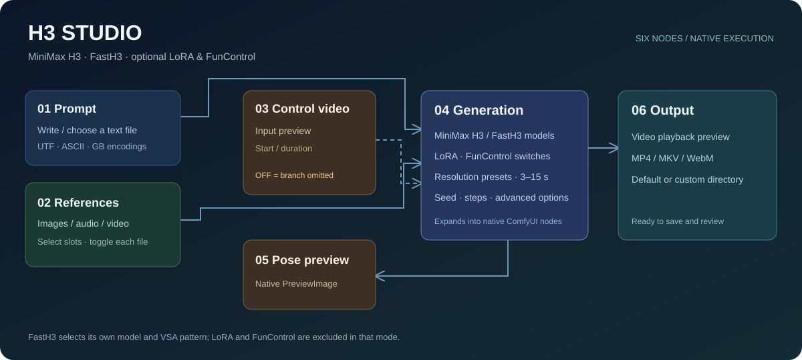

# ComfyUI-H3-Studio

**把 MiniMax H3 多参考、FastH3 和 FunControl，收进一个六节点工作台。**

An integrated ComfyUI workbench for MiniMax H3 and FastH3, with optional LoRA / FunControl branches, reference selection, prompt-file input and video previews. [English quick start](docs/README.en.md).


[](https://github.com/66666233336666623333/ComfyUI-H3-Studio/actions/workflows/checks.yml)
[](THIRD_PARTY_NOTICES.md)

[下载工作流](examples/H3_Studio.json) · [模型准备](docs/MODELS.md) · [注意力与性能](docs/ATTENTION.md) · [验证范围与限制](docs/VALIDATION.md)



*结构示意图。实际界面保留输入视频、姿态和成片预览，预览内容由使用者自己的素材与运行结果提供。*

## 能做什么

| 工作台 | 功能 |
| --- | --- |
| 提示词 | 多行手写、文本文件、文件 + 手写补充；支持 UTF、ASCII、GB2312 / GBK / GB18030 |
| 参考选通器 | 9 个图片槽、3 个音频槽、3 个视频槽，混合最多启用 12 个文件；逐项启停、批量选择 |
| 控制视频 | 上传与播放预览；选择起始时间和截取时长 |
| 生成控制台 | MiniMax H3 / FastH3 模型选择，加速 LoRA / FunControl 开关，分辨率预设、3–15 秒时长、种子与步数 |
| 姿态预览 | 原生 PreviewImage 显示 FunControl 提取的姿态 |
| 保存与预览 | MP4 / MKV / WebM；默认官方 output，也可指定目录；成片播放预览 |

**FunControl 关闭时，整条控制分支都不加入执行图。** 不创建控制视频读取、抽帧、检测器、SDPose、模型补丁加载和 FunControl Apply 节点。LoRA 关闭时也不创建其加载节点。之前运行留下的缓存仍由 ComfyUI 管理，开关不会强制清空全局缓存。

## 安装与第一次使用

1. 准备支持原生 MiniMax H3、FunControl、SDPose 和稀疏注意力的 ComfyUI。开发检查基线是 `v0.43.0-10-gc7bd15c2`、Python 3.12；这不是对所有较早或较新版本的兼容承诺。
2. 在 **ComfyUI 的 Python 环境**中，将本仓库放入 `ComfyUI/custom_nodes/comfyui-h3-studio`：

   ```shell
   cd ComfyUI/custom_nodes
   git clone https://github.com/66666233336666623333/ComfyUI-H3-Studio.git comfyui-h3-studio
   ```

   已有同名旧版节点包时，先备份再替换；同一安装中只保留一份 H3 Studio，避免重复节点与路由。无需另外安装旧的 `comfyui-h3-reference-guard`，所需参考组件已内置。此包没有额外 pip 依赖，仍需完整的 ComfyUI 运行环境。
3. 按[模型清单](docs/MODELS.md)准备文件，重启 ComfyUI 并刷新浏览器。
4. 下载 [H3_Studio.json](examples/H3_Studio.json)（GitHub 文件页的下载按钮），拖入 ComfyUI。API 用途可参考 [H3_Studio.api.json](examples/H3_Studio.api.json)；其中不包含自动提交任务的脚本。
5. 检查两类主模型的下拉选择，再填写提示词或上传文本。示例默认 **FastH3、960×544、5 秒、种子 0、空参考、关闭 LoRA / FunControl**。
6. 需要参考时打开参考管理面板；需要姿态控制时关闭 FastH3、开启 FunControl，并选择控制视频。配置完成后自行提交生成。

工作流只有五个自定义面板和一个原生预览节点。生成面板通过 ComfyUI node expansion 展开成原生采样、解码和控制节点；安装不会修改官方节点源码。

## 模式怎么选

| FastH3 | 加速 LoRA | FunControl | 实际执行 |
| --- | --- | --- | --- |
| 开 | 任意 | 任意 | FastH3 权重，8 步默认，VSA 10%，视频 / 音频 Sigma Shift 12 / 3；LoRA 与 FunControl 不参与 |
| 关 | 关 | 关 | 普通 MiniMax H3，默认 20 步 |
| 关 | 开 | 关 | 普通 H3 + 兼容的加速 LoRA，默认 8 步 |
| 关 | 关或开 | 开 | 普通 H3 + FunControl，可叠加兼容 LoRA |

FastH3 下拉栏必须选择 **FastH3 专用权重**。普通 H3 即使文件名带 NVFP4，也不等于 FastH3。FastH3 使用训练对应的稀疏结构，不能随意改成 SLA / Sol-Attn。普通 H3 模式沿用当前 ComfyUI 的默认注意力后端。[详解](docs/ATTENTION.md)。

## 时长、分辨率与参考

- 时长界面是 3–15 秒、24 fps，按 MiniMax H3 的 `17k+5` 帧网格向上分档。没有额外裁切或第二套严格时长校验。
- 3 秒 → 73 帧 / 约 3.04 秒；5 秒 → 124 帧 / 约 5.17 秒；12 秒 → 294 帧 / 12.25 秒；15 秒 → 362 帧 / 约 15.08 秒。
- 分辨率包含横屏、竖屏、方形与 4:3 预设。16:9 / 9:16 标签表示近似方向比例，**以实际像素尺寸为准**。
- 每个参考槽只接一个文件，未启用的槽位不读取文件。图片最多 9 张；音频、视频分别最多 3 段、各合计 15 秒，每段 2–15 秒。
- 勾选“使用视频自带音轨”后，这些音轨与独立音频合计最多 3 段、15 秒。视频音轨不另占混合文件数量。
- 提示词中的参考标签按当前启用素材的顺序生成，例如 `<Picture 1>`、`<Video 1>`、`<Audio 1>`；空槽会跳过。音频标签先计入视频中的音轨，再计独立音频。
- **参考视频与 FunControl 控制视频是不同用途。** 关闭 FunControl 不会关闭参考选通器中勾选的视频。参考视频保留自身时长，降低生成时长不会自动缩短参考视频。

## 文本与输出目录

文本支持 `.txt`、`.md`、`.markdown`、`.text`、`.rst`、`.log`、`.json`、`.yaml`、`.yml`、`.csv`、`.srt`，按纯文本读取，不执行 Markdown 或脚本；单文件最多 4 MiB。上传保存到当前 ComfyUI 的 `input/h3_studio_prompts`。手写模式不会读取文件栏中的旧路径。

自动编码依次检查 BOM、UTF-8、GB18030。编码无法完全靠内容识别；无 BOM 的 UTF-16 / UTF-32 请手动选择大小端，乱码时也应手动指定。解码失败会报错，不静默替换字符。

输出目录留空使用 ComfyUI 官方 output；相对路径如 `video/H3_Studio` 位于 output 内，绝对路径使用指定位置。输出在官方目录之外时，会在临时目录建立硬链接或复制一份用于预览。不会改变 ComfyUI 全局输出目录。

## 已知限制

- **预览版，未对所有模型、GPU、操作系统与参考组合完成生成验证。** 本次发布检查不运行扩散生成。此前开发版本有 FastH3 + 图片 / 音频参考的成功记录，不代表本次公开包完成了全面推理验收。
- 长参考视频会显著增加编码与注意力负载。开发环境曾出现 FastH3 加入长参考视频后长时间无采样进度；未确定是计算、显存换页还是具体内核问题，当前发布不宣称修复。首次试用建议使用短任务与图片参考，逐项增加素材。
- “关闭的分支不加载”是当前执行图的行为，不是显存立刻清零的保证。
- 依赖原生 H3 的部分内部接口；ComfyUI 更新可能影响兼容性。请保留可回退的环境。
- 视频保存遵循 ComfyUI 元数据设置，可能包含提示词、参考文件名与工作流。对外分享自己的成片前请检查元数据。仓库示例不包含私人素材或成片。

## 开发与验证

[AGENTS.md](AGENTS.md) 提供目录、实现边界和检查命令。[VALIDATION.md](docs/VALIDATION.md) 记录已验证与未验证的范围。轻量 CI 只检查文本、路径、帧分档、示例默认值和参考管理状态，不下载模型。

项目展示参考了 [ComfyUI Examples](https://github.com/comfyanonymous/ComfyUI_examples) 的可下载工作流入口，以及 [VideoHelperSuite](https://github.com/Kosinkadink/ComfyUI-VideoHelperSuite) 的节点与预览说明形式；代码组织参考 [ComfyUI 扩展模板](https://github.com/Comfy-Org/cookiecutter-comfy-extension)。这些项目不是本包新增安装依赖。

## 许可与致谢

新增工作台代码、前端、示例和文档使用 [MIT](LICENSE)。`reference/conditioning.py` 含有基于 ComfyUI 原生 H3 实现的改写，保留 [GPL-3.0](LICENSES/GPL-3.0.txt)；完整分发包同时包含这两类许可，不能将其中 GPL 部分重新标为 MIT。[逐文件范围与来源](THIRD_PARTY_NOTICES.md)。模型权重不包含在仓库中，其许可证由各模型发布方决定。

感谢 [ComfyUI](https://github.com/Comfy-Org/ComfyUI)、[Comfy Kitchen](https://github.com/Comfy-Org/comfy-kitchen) 与 [FastVideo](https://github.com/hao-ai-lab/FastVideo) 提供的原生节点、计算内核与加速研究。本项目是社区工作台，不代表上述项目官方发布。
